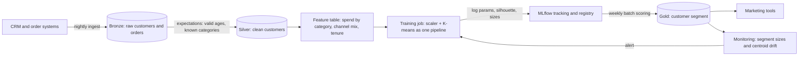

# Customer segmentation with K-means

Who are a retailer's customers, really? I cleaned 2,240 customer records, tested whether PCA helped, chose the number of clusters with two methods, and turned the result into two segments a marketing team can act on: **established, high-spending households** and **younger families who browse online, spend less and buy on deals**.

| | |
|---|---|
| Technique | Unsupervised learning: K-means clustering, PCA check, elbow and silhouette analysis |
| Data | 2,240 customers, 29 attributes ([public, CC0](data/README.md)) |
| Result | 2 segments: 922 and 1,318 customers |
| Stack | Python, pandas, scikit-learn, Matplotlib, seaborn |

> **Where the numbers come from.** Every number in this README comes from my original run of the analysis (Google Colab, 2026), copied from the executed notebook's outputs. I rebuilt the code into this repo afterward and have not yet re-run it on the real dataset, which isn't committed here. `make reproduce` re-runs everything on the real file and checks the results against [`results/reference_metrics.json`](results/reference_metrics.json).

## Business problem

A growing retailer markets to every customer the same way. It wants to know which groups of customers exist, how they differ, and how to market to each, so campaigns convert better and high-value customers stay.

There is no "right answer" column in the data, so the hard part is judgment: which features to use, how many groups are real, and whether the groups mean anything to a marketer.

## Data

Each row is one customer: birth year, education, marital status, household income, children and teenagers at home, enrollment date, days since last purchase, two years of spending in six product categories, purchases by channel (web, catalog, store, deals), monthly web visits, and responses to six marketing campaigns. Details and download steps: [`data/README.md`](data/README.md).

## Approach

1. **Checked data quality.** No duplicate rows. Found 24 missing incomes, three impossible ages (126, 127 and 133), and four joke marital-status values.
2. **Cleaned with explicit, tested rules** ([`cleaning.py`](src/segmentation/cleaning.py)), each counted in a report:

   | Problem | Fix | Why |
   |---|---|---|
   | 24 missing incomes | Median ($51,381.50) | Income has extreme outliers (max $666,666) that pull the mean |
   | Birth year | Age at a fixed reference year (2026) | Easier to read; a fixed year keeps results reproducible |
   | 3 impossible ages | Mean of valid ages, rounded (57) | Keeps those customers' spending data |
   | "Alone" (3 records) | Single | Same meaning |
   | "Absurd", "YOLO" (4 records) | Most common status (Married) | Not real categories |

3. **Explored correlations.** Spending rises with income and with catalog and store purchases; customers with young children visit the website more and spend less. Recency and days-as-customer barely correlate with anything, so I left them out.
4. **Scaled 15 features** (age, income, six spending categories, deal purchases, four channel measures, children and teenagers at home) with z-scores, so dollars don't dominate the distance calculation.
5. **Tested PCA and rejected it.** Keeping 92.4% of the variance needed 11 of 15 components: little compression, and clusters on components are hard to explain.
6. **Chose k with two methods.** The elbow plot left k = 2 or 3 open; the silhouette score settled it at **k = 2**.
7. **Fit the final model and profiled the clusters** with mean scaled values and box plots.

## Results

Segment sizes and mean scaled values (0 = the average customer; positive = above average). Source: original run.

| Measure | Segment A: established, high-spending households | Segment B: younger families |
|---|---|---|
| Customers | 922 | 1,318 |
| Income | +0.77 | −0.54 |
| Wine / meat spending | +0.86 / +0.83 | −0.60 / −0.58 |
| Fruit / fish / sweets / gold spending | +0.72 / +0.74 / +0.73 / +0.60 | −0.51 / −0.52 / −0.51 / −0.42 |
| Catalog / store purchases | +0.88 / +0.84 | −0.62 / −0.59 |
| Web purchases | +0.60 | −0.42 |
| Web visits per month | −0.68 | +0.47 |
| Deal purchases | −0.18 | +0.12 |
| Children / teenagers at home | −0.71 / −0.12 | +0.49 / +0.09 |
| Age | +0.17 | −0.12 |

**What I'd tell marketing**

- **Segment A** spends across every channel and rarely buys on deals. Don't train them to wait for discounts. Invest in retention, premium ranges (wine and meat, where they sit furthest above average), and catalog and in-store experiences.
- **Segment B** visits the website often but spends less and is more likely to buy on a deal. Target them online with family-oriented offers and web-only deals, and measure whether the visits turn into larger baskets.

## Decisions and trade-offs

**Cluster on scaled features, not PCA components.** PCA kept 92.4% of the variance only with 11 of 15 components. Clustering on the original (scaled) features keeps segments explainable ("higher income, fewer children"); the lost dimensionality saving doesn't matter at 2,240 rows.

**Two segments, not three.** The elbow plot was ambiguous; the silhouette score preferred k = 2. Two segments means two campaigns a team can actually run. Finer segments inside Segment B are a next step, not a starting point.

**Fix bad values, don't drop rows.** Dropping the 27 customers with a missing income or an impossible age would have been simpler, but their spending data is valid and spending drives the clusters.

**Name segments by income, not by K-means label.** K-means numbers clusters arbitrarily, so the code names the higher-income cluster "Segment A". Results stay comparable across library versions and re-runs.

**What I changed when I rebuilt the code** (none of these should change the reported results; `make reproduce` checks):
- Fixed the random seed for the elbow and silhouette loops too, not just the final model.
- Measured tenure from a fixed date instead of "today"; tenure isn't a clustering feature.
- Rewrote the plotting helpers and moved all logic into a tested package.

## How to run

```bash
make setup && source .venv/bin/activate   # Python 3.12+; pinned versions tested on 3.14
make test                                 # unit tests (synthetic data, no download needed)
make demo                                 # full pipeline on synthetic data
# Real results: download the dataset (data/README.md) to data/raw/marketing_campaign.csv, then
make reproduce                            # writes results/metrics.json and compares with the original run
make notebook                             # runs notebooks/customer_segmentation.ipynb top to bottom
```

## Repo layout

```
src/segmentation/
  config.py      seed, reference year, feature list
  data.py        load and validate the raw file
  cleaning.py    cleaning rules + CleaningReport
  features.py    feature selection and scaling
  modeling.py    PCA check, elbow, silhouette, K-means, profiles
  pipeline.py    end-to-end run and comparison with the reference run (CLI)
  synthetic.py   fake data with the real schema, for tests and demos
notebooks/customer_segmentation.ipynb   the analysis, step by step
results/reference_metrics.json          numbers from the original run
tests/                                  pytest suite
```

## In production on Databricks (design)

This is how I would run it in production. It's a design, not something I have deployed.



- **Pipeline:** nightly ingestion into Delta tables (Bronze to Silver), with data-quality expectations that quarantine impossible ages and invalid categories instead of patching them by hand.
- **Features:** a customer feature table (spend by category, channel mix, tenure) in the feature store, computed once and reused by other marketing models.
- **Training and tracking:** scaling and K-means as a single pipeline logged in MLflow, with the silhouette score and segment sizes on every run.
- **Serving:** a weekly batch job writes each customer's segment to a Gold table the marketing tools read.
- **Monitoring:** alert when segment sizes or centroid profiles drift beyond agreed limits, a sign the customer base has changed and the segments need review.

## What I'd do next

- Test k = 3 and Gaussian mixture models to see whether Segment B splits into groups worth separate campaigns.
- Validate the segments against past campaign responses, which I left out of the clustering, before spending money on them.
- Track segment membership over time to see how customers move between segments.

## About

I built this project in the AI & Data Science Program: Leveraging Responsible AI, Data and Statistics for Practical Impact (MIT IDSS, delivered through Great Learning), 2026. The analysis, code and write-up are my own. Code is MIT licensed; the dataset has its own license (see [`data/README.md`](data/README.md)).
